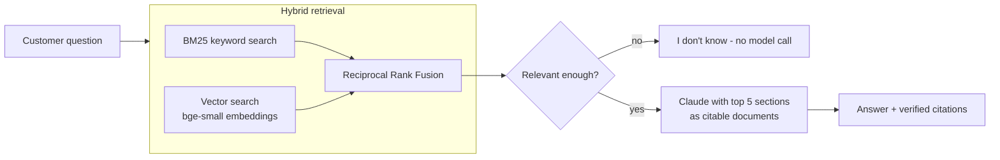

# RAG Service Assistant

A retrieval-augmented Q&A assistant for a service business. It answers customer questions **only from the company's own documents**, shows the **exact source passage** behind every claim, and says **"I don't know"** instead of guessing.

The sample company, *BrightClean Services*, is fictional. Its five policy documents (services, pricing, booking and cancellation, FAQ, service area) live in [`data/brightclean/`](data/brightclean/). Point the assistant at another folder of Markdown files and it works the same way.

## How it works



1. **Chunking by section.** Each `##` section of a document becomes one chunk, so every citation points to a section a person can find in the source file.
2. **Hybrid retrieval.** BM25 catches exact terms ("lockout", "Zone B"). Embeddings catch paraphrases ("nobody opened the door"). Reciprocal Rank Fusion merges both rankings without calibrating their different score scales.
3. **Relevance gate.** If even the best section is far from the question, the assistant answers "I don't know" without calling the model, which saves cost and blocks off-topic answers.
4. **Grounded generation with API citations.** The retrieved sections are sent to Claude as separate `document` blocks with [citations](https://platform.claude.com/docs/en/build-with-claude/citations) enabled. The API returns which passage supports each sentence, so citations are verified by the API rather than written by the model.

## Handling hallucinations, failures and security

| Risk | What this project does |
|---|---|
| Hallucinated facts | Answers only from retrieved documents; API-level citations for every claim; fixed "I don't know" reply when the answer isn't there |
| Off-topic questions | Similarity gate stops clearly unrelated questions before any model call |
| Prompt injection in documents | System prompt treats documents as reference material, not instructions |
| Model refusals | Server-side fallback model, plus a friendly reply if the request is still declined |
| API errors | SDK retries for rate limits and server errors; clear messages for a missing key, network problems and API errors |
| Secrets | API key only in `.env`, which is git-ignored |

## Evaluation

[`eval/questions.jsonl`](eval/questions.jsonl) has 24 questions: 18 that the documents answer and 6 they don't (e.g. "Do you clean swimming pools?").

```bash
uv run python eval/run_eval.py        # retrieval only, free
uv run python eval/run_eval.py --llm  # end to end with Claude
```

**Retrieval result:** the correct section is in the top 3 for **18 of 18** answerable questions.

## Run it

Requires Python 3.11+ and [uv](https://docs.astral.sh/uv/).

```bash
git clone https://github.com/lequangninh/rag-service-assistant.git
cd rag-service-assistant
cp .env.example .env          # then add your ANTHROPIC_API_KEY
uv sync

uv run streamlit run app.py   # web demo
uv run python ask.py "Can I cancel the day before?"   # terminal
uv run pytest                 # tests
```

The first run downloads the embedding model (about 130 MB) and caches the document vectors in `.index/`.

## Project structure

```
rag/
  chunking.py   split Markdown into section chunks
  retrieve.py   BM25 + vector search + rank fusion
  answer.py     relevance gate, Claude call with citations, refusal handling
  pipeline.py   wires retrieval and answering together
app.py          Streamlit web demo
ask.py          command-line interface
eval/           evaluation questions and runner
tests/          unit tests (no API key needed)
data/           the sample company's documents
```

## Tech

Python · Claude API (Anthropic SDK, citations) · fastembed (BAAI/bge-small-en-v1.5) · NumPy · Streamlit · pytest

---

Built by [Ninh Le](https://github.com/lequangninh), AI Automation Engineer.
